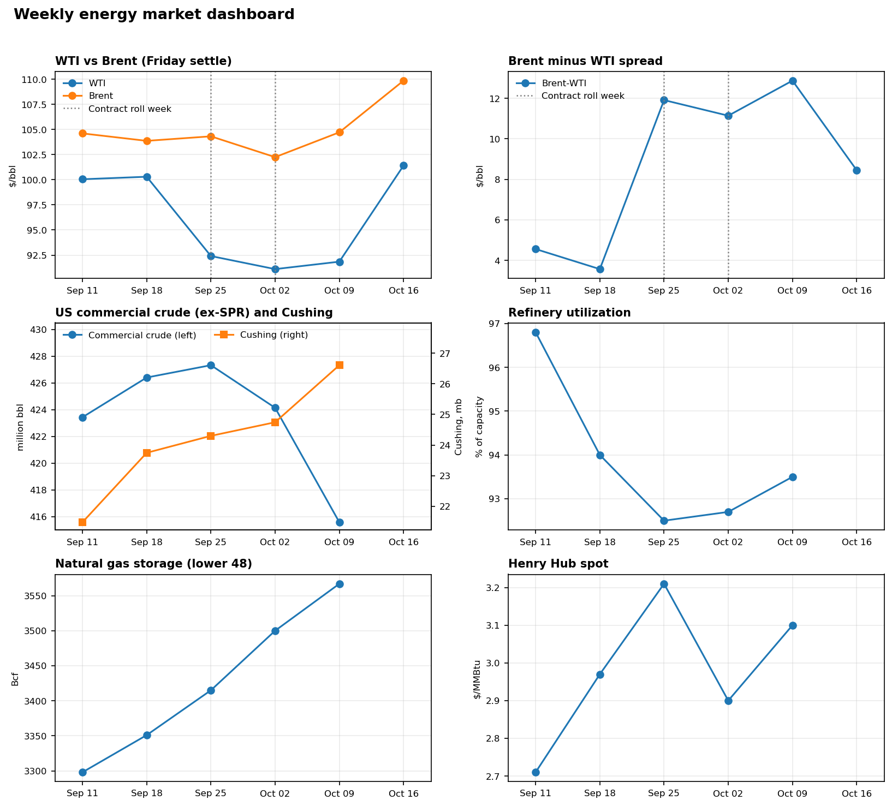

# Weekly Energy Market Dashboard

I track the US oil and gas market every week to build real fluency in how energy markets move and to practice explaining why. I started the week of Sept 14, 2026. The project has a weekly data table, a notebook that charts it, and a short written read of each week.



## Latest read

Week ending Oct 9: Hurricane Isaias shut in most US Gulf offshore oil output while Iran talks and China's planned product-export restart eased supply fears. WTI $91.85, Brent $104.72. [Full entry](commentary/2026-10-09.md) · [All weeks](commentary/README.md)

## What's in this repo

| File | What it is |
|---|---|
| `data/weekly.csv` | One row per week with prices, inventories, storage, utilization and weather |
| `dashboard.ipynb` | Notebook that charts the data and shows the latest week against the prior one |
| `commentary/` | My five-sentence read of each week, with sources ([index](commentary/README.md)) |
| `update_data.py` | Script I run to add new weeks and pull data from EIA, Yahoo Finance and Open-Meteo |
| `contract_rolls.py` | Computes WTI and Brent contract expiry dates and flags the weeks that contain a roll |
| `tests/` | Tests for the contract-roll calculation |
| `forecasting/` | Day-ahead NYISO load forecast built on the same EIA data ([README](forecasting/README.md)) |

## Commentary

Every week I write five sentences on what changed and why, and link the sources I used. I wrote the first four weeks (Sept 18 to Oct 9, 2026) together on Oct 12 as a catch-up, and from there I write each one at the end of the week.

## What I track

| Group | Metrics | Source |
|---|---|---|
| Crude prices | WTI and Brent Friday settles, Brent-WTI spread | CME / ICE (via Yahoo Finance) |
| Gas price | Henry Hub spot | EIA |
| Crude fundamentals | Commercial crude (ex-SPR), Cushing, refinery utilization, gasoline stocks | EIA Weekly Petroleum Status Report |
| Gas fundamentals | Working gas in storage | EIA Weekly Natural Gas Storage Report |
| Power and weather | Lower-48 electricity demand, HDD/CDD proxy | EIA Grid Monitor, Open-Meteo |

A week runs Saturday to Friday and is labelled by the Friday. EIA releases petroleum data the following Wednesday and gas storage the following Thursday, so the newest row is usually incomplete until then.

## How I update it each week

1. After the Friday close, I run `python update_data.py` to add the new week and fill in what has been published.
2. Once EIA releases inventories and storage (Wednesday and Thursday), I run it again.
3. I run all cells in `dashboard.ipynb`.
4. I write that week's five sentences in `commentary/`, using the previous entry as a template.
5. I commit the data and the commentary separately, then push:

   ```
   git add data/weekly.csv && git commit -m "Data: week ending YYYY-MM-DD"
   git add commentary && git commit -m "Commentary: week ending YYYY-MM-DD"
   git push
   ```

## Setup

```bash
pip install -r requirements.txt
export EIA_API_KEY=your_key      # free at https://www.eia.gov/opendata/
python update_data.py
jupyter notebook dashboard.ipynb
```

By default `update_data.py` only fills blank cells. `--overwrite` replaces existing values with fresh API data. Each data source runs separately, so if one fails the script prints a "skipped" line and keeps going.

## Data notes

- WTI and Brent are Friday front-month futures settles from Yahoo Finance. Inventories, storage, Henry Hub and electricity demand come from the EIA API, and weather comes from Open-Meteo, so running `update_data.py` reproduces the table.
- Yahoo's continuous futures (`CL=F`, `BZ=F`) switch to the next contract near expiry, which can distort weekly changes, especially for Brent. `update_data.py` computes each contract's expiry date (WTI: three business days before the 25th of the month before delivery; Brent: last business day of the second month before delivery) and records it in `wti_roll_date` and `brent_roll_date` for the week it falls in. The notebook marks those weeks on the charts. The calendar is approximate and Yahoo can switch a day or two away from expiry, so a flag means a roll happened around that week. Brent rolled from November to December in the week ending Oct 2, for example.
- HDD/CDD is an unweighted average of five large cities, so it is only a rough stand-in for the population-weighted NOAA figure.

## To do

- Add the week ending Oct 9 inventory and storage data after EIA releases it on Oct 14 and 15.
