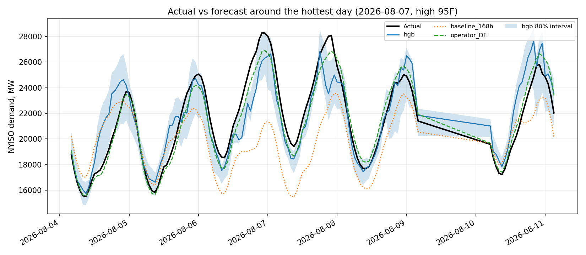
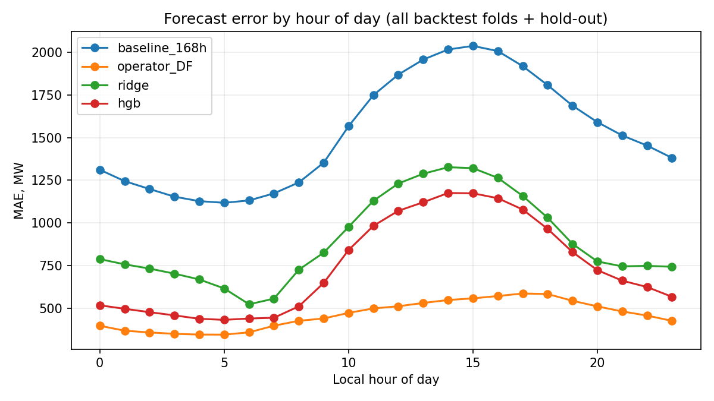
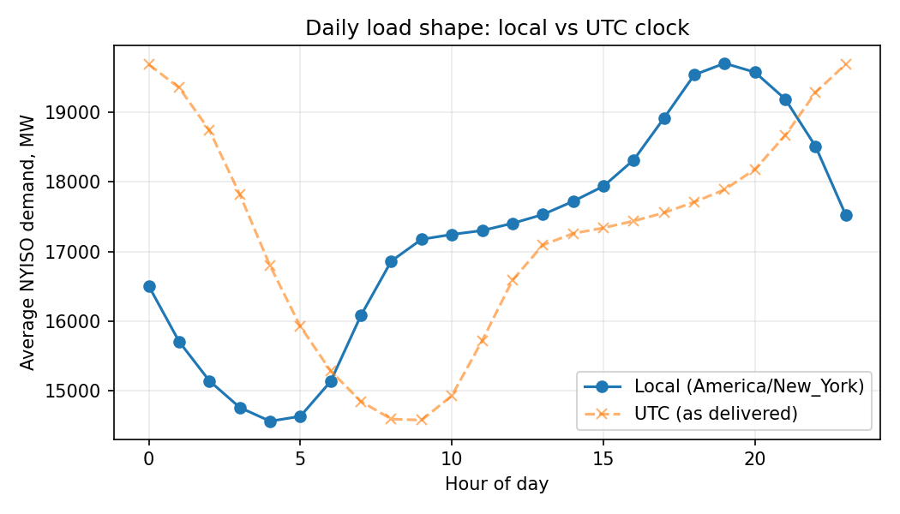

# Day-Ahead Load Forecast (NYISO)


A day-ahead hourly electricity demand forecast for the New York ISO, built with EIA and weather data. It compares two simple baselines against ridge regression and gradient boosting, evaluates them with a leakage-free monthly backtest, and analyzes where the models fail, including on heat-wave days.

Part of my [weekly energy market dashboard](../README.md). It reuses the same EIA API key and the same pattern of a fetch script that caches data to CSV.

## Forecast definition

The forecast is made at **10:00 local time on day D-1 for all 24 hours of day D**. At that moment the latest observed demand is the hour ending 09:00 on D-1, so the targets are 15 to 38 hours ahead.

To make leakage impossible by construction, every demand-based feature is lagged by **at least 48 hours**, plus the same hour one week earlier (168 hours). Same-hour-yesterday is deliberately not used. A test (`tests/test_forecasting.py`) perturbs the 47 hours before a target and confirms no feature changes.

**Limitation:** the temperature features use the *actual* temperature at the target hour, which assumes a perfect weather forecast. Real day-ahead errors would be larger than reported here.

## Data

| Series | Source | Notes |
|---|---|---|
| Demand | EIA API v2, `electricity/rto/region-data`, respondent NYIS, type D | Hourly, UTC, Jan 1 2022 to present |
| Operator forecast | Same route, type DF | Used as the toughest benchmark if well populated |
| Temperature | Open-Meteo historical archive, New York City (40.71, -74.01) | Hourly, Fahrenheit, requested in UTC |

`fetch_data.py` caches everything to `data/*.csv`, so the APIs are not hit again. `clean.py` then:

- puts demand on a complete hourly UTC grid, so a lag of 168 rows is exactly 168 hours;
- sets non-positive values to missing and removes spikes (a value more than 25% away from the median of the four surrounding hours);
- linearly interpolates gaps of 3 hours or less and leaves longer gaps missing (those rows are dropped from modeling rather than invented);
- writes counts of everything it changed to `results/quality_report.json`.

**Timezone check:** EIA hourly timestamps are UTC. Features use `America/New_York`, which handles daylight saving. `clean.py` plots the average daily load shape by local hour (`charts/daily_shape.png`) and checks that the overnight low falls between 2 and 6 and the peak between 14 and 20 local time. A UTC reading would be shifted 4 to 5 hours.

## Features

Hour of day, day of week, month, weekend flag, US federal holiday flag; temperature, temperature squared, heating and cooling degrees (65F base); demand 48 and 168 hours earlier; a 24-hour rolling mean of demand ending 48 hours back.

## Models and baselines

| Name | Description |
|---|---|
| `baseline_168h` | Same hour last week |
| `operator_DF` | NYISO's own day-ahead forecast, if available |
| `ridge` | Ridge regression with hour, day-of-week and month dummies plus the numeric features |
| `hgb` | scikit-learn `HistGradientBoostingRegressor`, fixed seed, 300 iterations |

## Validation

Time-based only, never shuffled. Expanding-window folds, each testing one calendar month after training on everything before it (starting after 12 months of history), plus a final hold-out of the last 3 months. Models are retrained inside every fold. Metrics: MAE (MW), MAPE and RMSE per fold and averaged, plus MAE on the top 5% load hours. Skill score is `1 - MAE_model / MAE_baseline`.

## Results

Time-based backtest with monthly expanding-window folds plus a final three-month hold-out; MAE is in megawatts.

| Model | Backtest MAE (MW) | Hold-out MAE (MW) | Hold-out MAPE | Hold-out top-5% hours MAE (MW) | Skill vs same hour last week | Skill vs operator |
|---|---|---|---|---|---|---|
| baseline_168h | 1,512 | 1,724 | 10.0% | 2,754 | 0.00 | -2.91 |
| operator_DF | 461 | 441 | 2.5% | 705 | 0.74 | 0.00 |
| ridge | 889 | 992 | 5.9% | 1,435 | 0.42 | -1.25 |
| hgb | 736 | 840 | 4.9% | 1,352 | 0.51 | -0.90 |

1. On the final 1,868-hour hold-out, gradient boosting had a mean absolute error of 840 MW (4.9%), against 1,724 MW for the same hour last week, a skill score of 0.51.
2. Ridge regression reached 992 MW, so gradient boosting was 15% lower in error than the linear model.
3. On the top 5% of load hours the hold-out error rose to 1,352 MW.
4. NYISO's own day-ahead forecast had a hold-out error of 441 MW, 53% of my model's, so the operator forecast remains the one to beat.
5. Error was largest at local hour 14 (1,175 MW), and on heat-wave days (daily high of 90F or more, 1,824 hours) it averaged 1,140 MW against 719 MW on other days across the whole backtest.
6. The 10th-to-90th percentile interval from quantile gradient boosting covered 66% of hold-out hours against a nominal 80%, with an average width of 2,071 MW and 32% coverage on heat-wave hours.
7. Permutation importance on the hold-out ranked temp_f and lag_48 as the most important features.

**Actual vs forecast around the hottest day**



**Forecast error by hour of day**



**Average daily load shape, local vs UTC clock**



## Error analysis

`results/error_analysis.csv` breaks MAE down by local hour, weekday vs weekend vs holiday, heat-wave days (daily high of 90F or more) and cold snaps (daily low of 20F or less). `results/permutation_importance.csv` shows which features matter most on the hold-out.

## How to run

```bash
pip install -r ../requirements.txt
export EIA_API_KEY=your_key
python fetch_data.py       # downloads and caches raw data (a few minutes the first time)
python clean.py            # builds data/hourly.csv and results/quality_report.json
python run_forecast.py     # backtest, error analysis, intervals, charts
pytest tests               # no network needed
```

`python run_forecast.py --quick` uses fewer boosting iterations for a fast smoke test.

## Limitations

- Actual temperature is used as a feature, which assumes a perfect weather forecast.
- One temperature point (New York City) stands in for all of NYISO, which also covers upstate New York.
- Lags are counted in elapsed hours, so around the two daylight-saving changes each year a 168-hour lag is one clock hour off.
- The heat-wave and cold-snap samples are small, so those error numbers are noisy.
- No weather-forecast uncertainty and no explicit modeling of behind-the-meter solar or demand response.
